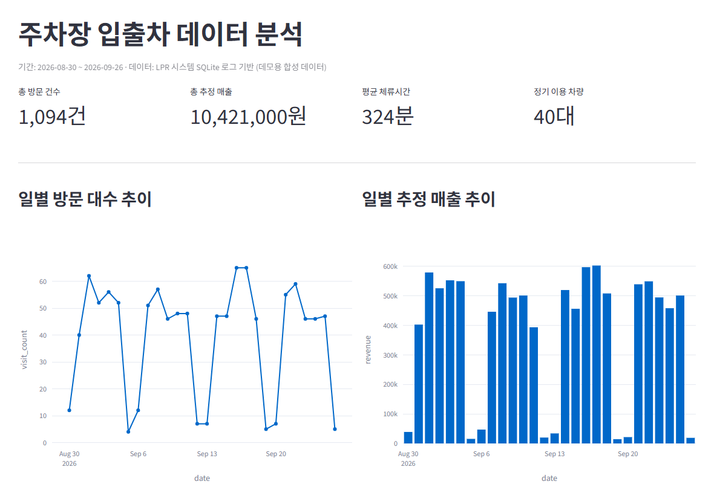
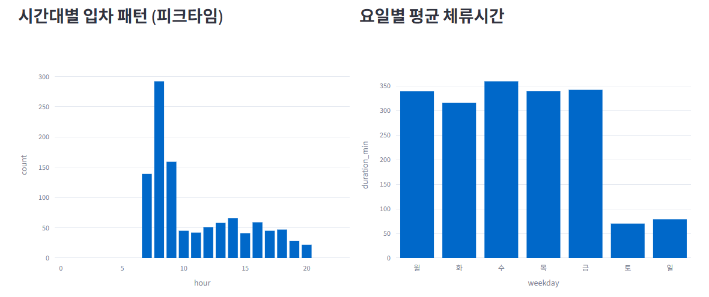
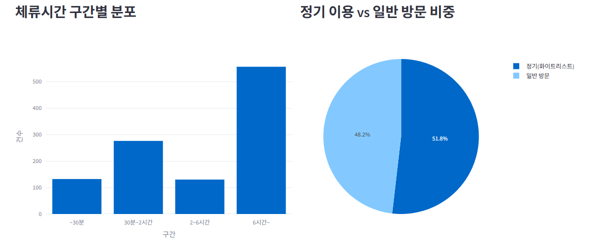
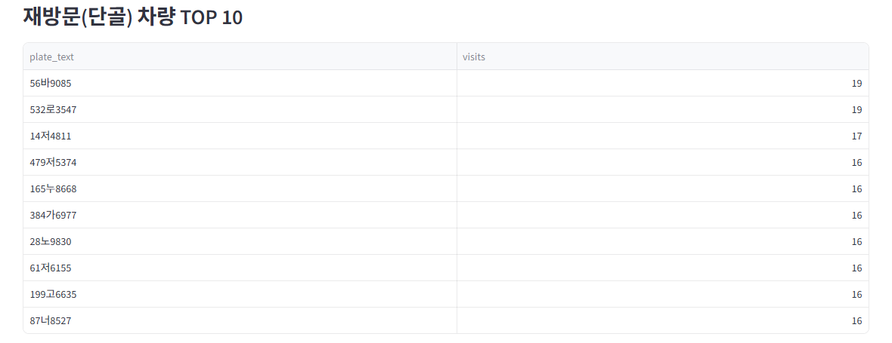
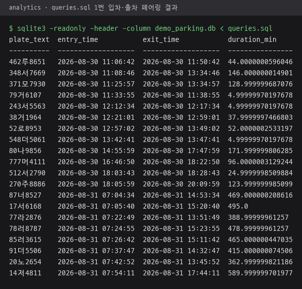
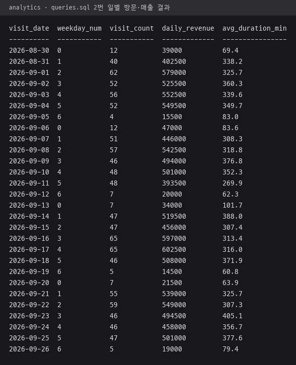
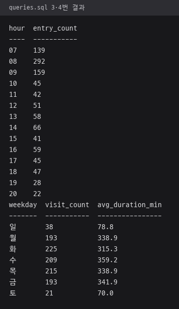
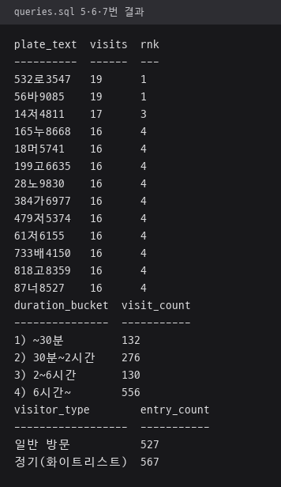

# 주차장 입출차 데이터 분석

LPR 시스템(`lpr_system/`)이 SQLite에 쌓는 입출차 로그를 SQL로 분석하고
Streamlit 대시보드로 시각화한다. 검출·인식 파이프라인이 만든 데이터를
비즈니스 인사이트로 바꾸는 것이 목적.

> **데이터 안내**: 실 카메라 배포 전이라 `demo_parking.db`는 합성 데이터다.
> 테이블은 분석에 쓰는 `plate_logs`, `entry_exit_log`, `whitelist` 3개뿐이고, 앱 DB의 `blacklist`, `camera_config`, `overstay_log`는 없음.
> `plate_logs`, `entry_exit_log` 컬럼은 `lpr_system/database.py`와 같고, `whitelist`에는 앱 DB의 `phone`, `memo`, `expires_at` 컬럼이 없음.
> 대시보드와 `queries.sql`은 세 테이블의 공통 컬럼만 쓰므로, 실제 데이터가 쌓이면 `DB_PATH`만 `lpr_system/parking.db`로 바꿔 그대로 사용 가능.

## 구성

| 파일 | 설명 |
|---|---|
| `generate_sample_data.py` | 오피스 주차장 4주치 합성 데이터 생성 (정기 출퇴근 40대 + 방문 차량) |
| `queries.sql` | 분석 쿼리 모음 — LAG 윈도우 함수로 입/출차 페어링, CTE, RANK 등 |
| `dashboard.py` | Streamlit 대시보드 |
| `demo_parking.db` | 생성된 샘플 DB (재실행 시 자동 갱신) |

## 실행

```bash
python -m venv dash_env
dash_env\Scripts\pip install -r requirements.txt

# (선택) 데이터 재생성
dash_env\Scripts\python generate_sample_data.py

# 대시보드 실행
dash_env\Scripts\python -m streamlit run dashboard.py
```

> `dash_env`는 `lpr_system`의 가상환경(`lpr_env`)과 **완전히 분리**되어 있다.
> streamlit이 요구하는 최신 protobuf가 paddlepaddle(`<=3.20.2` 고정)과
> 충돌하기 때문에, 메인 앱 환경을 건드리지 않도록 독립 venv로 격리했다.

## 분석 내용

- 일별 방문 대수 · 추정 매출 추이
- 시간대별 입차 패턴 (피크타임)
- 요일별 평균 체류시간 (평일 vs 주말)
- 체류시간 구간별 분포
- 정기(화이트리스트) vs 일반 방문 비중
- 재방문(단골) 차량 TOP 10

### 대시보드 실행 화면

`dash_env`에서 `streamlit run dashboard.py`로 띄운 대시보드 화면. 데이터는 `demo_parking.db` 합성 데이터 28일분.

**기간·핵심 지표, 일별 방문 대수·추정 매출 추이**



| 시간대별 입차 패턴, 요일별 평균 체류시간 | 체류시간 구간별 분포, 정기 이용 vs 일반 방문 비중 |
|---|---|
|  |  |

**재방문 차량 TOP 10 표**



## SQL 포인트

`entry_exit_log`는 ENTRY/EXIT이 각각 별도 행이라, `LAG() OVER (PARTITION BY plate_text ORDER BY timestamp)`
로 같은 번호판의 직전 이벤트를 끌어와 방문 1건(입차~출차)으로 재구성한다.
요금 계산 로직(`parking_fee.py`)도 CASE 문으로 SQL에 동일하게 이식해
매출을 직접 집계한다. 자세한 쿼리는 `queries.sql` 참고.

### 쿼리 실행 결과

`sqlite3 -readonly -header -column demo_parking.db < queries.sql` 실행 결과. 쿼리 7종의 출력을 순서대로 나눠 담은 화면.

| 1번 입차·출차 페어링, 방문 앞 20건 | 2번 일별 방문 대수·추정 매출 |
|---|---|
|  |  |
| **3·4번 시간대별 입차, 요일별 방문 대수·평균 체류시간** | **5·6·7번 재방문 순위, 체류시간 구간, 정기 vs 일반 비중** |
|  |  |

재방문 TOP 10은 대시보드와 쿼리의 집계 방식이 다름. 대시보드는 출차까지 끝난 방문 수로 정렬해 위에서 10대를 자르고, `queries.sql` 5번은 입차 건수에 `RANK()`를 매겨 10위 이내를 모두 출력. 데모 데이터에는 공동 4위가 10대라 쿼리 결과는 13행.

---

## 데이터 도구 탐색

같은 데이터셋(`plate_logs`, `entry_exit_log`, `whitelist`)을 SQL 실행 환경에만
머물지 않고 여러 데이터 도구로 직접 다뤄봤다. CSV로 내보낸 뒤 각 도구에
맞는 방식으로 적재·탐색·시각화하는 과정을 연습했다.

**DB Browser for SQLite** — 원본 쿼리 검증

**Power Query** — CSV 3개(plate_logs / entry_exit_log / whitelist) 적재 후
테이블 간 관계 구성

**Power BI** — `plate_text` 필터, `event_type`별 집계 시각화

**Databricks (PySpark · Spark SQL)** — `spark.table()`로 Delta 테이블 로드,
DataFrame API와 `%sql` 매직 양쪽으로 동일 집계(`plate_color`별 건수) 수행.
JOIN 시 컬럼명 충돌(`AMBIGUOUS_REFERENCE`) 등 실제 디버깅 과정도 거쳤다.

> 목적은 "같은 질문(색상별 분포, 이벤트별 집계)에 도구별로 어떻게 접근하는가"를
> 비교하는 것 — SQL 엔진(SQLite/Spark SQL), ETL 도구(Power Query),
> BI 시각화(Power BI), 분산처리 프레임워크(PySpark)를 한 데이터셋 기준으로 훑었다.
