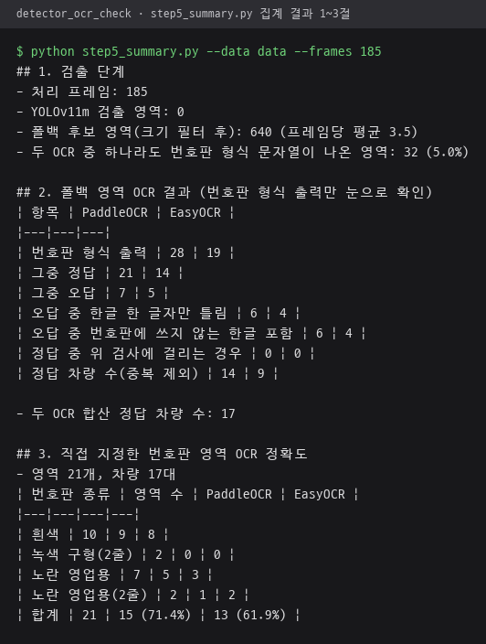
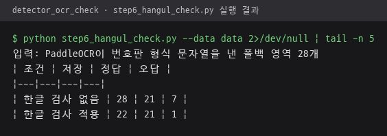

# experiments — 검증 실험 모음

앱 코드와 분리해 진행한 검증 실험 폴더 모음. 실험마다 하위 폴더 하나, 조건·실행 순서·결과는 각 폴더 README에 정리.
프로젝트 전체 설명은 [저장소 README](../README.md), 실험 결과 요약은 [3장 검증 실험](../README.md#3-검증-실험-인식-실패-원인-분리) 참고.

## 실험 목록

| 폴더 | 실험 내용 | 문서 |
|---|---|---|
| [`detector_ocr_check/`](detector_ocr_check) | 이전 버전 인식 실패 원인 분리. 직접 지정한 번호판 영역 21개로 PaddleOCR·EasyOCR 비교, 한글 검사 적용 전후 오답 수 비교 | [README](detector_ocr_check/README.md) |

## 진행 방식

현재 실험 `detector_ocr_check/` 기준.

- 앱 모듈 `lpr_system/`의 검출·OCR 코드를 수정 없이 불러와 사용
- 실험 영상, 원본 번호판 이미지, 중간 결과 `data/`는 `.gitignore`로 저장소 제외
- 공개용 그림은 번호 끝 4자리 가림 처리
- EasyOCR처럼 앱 환경과 버전이 충돌하는 라이브러리는 별도 가상환경에서 실행

## 재실행 결과

`detector_ocr_check/`의 저장소 제외 중간 결과 `data/`로 집계 5단계와 한글 검사 6단계를 다시 실행한 화면. 수치는 [실험 README](detector_ocr_check/README.md), 저장소 README 3장의 표와 동일.

| 5단계 `step5_summary.py` 집계, 1~3절 | 6단계 `step6_hangul_check.py` 한글 검사 전후 비교 |
|---|---|
|  |  |

5단계 출력의 4절은 촬영 각도가 다른 영상의 YOLO 비교라 문서에서 제외한 내용이므로 그림에서 뺌. 6단계는 앱 모듈 로딩 메시지를 빼고 결과 5줄만 표시.
