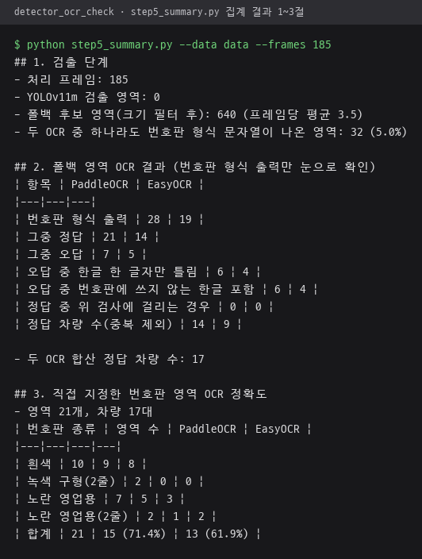
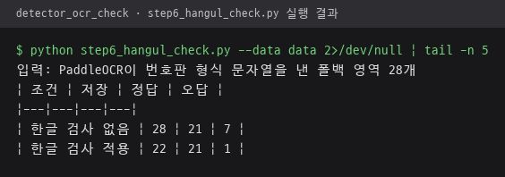

# 검출·OCR 검증 실험

이전 버전(YOLO n + EasyOCR)은 번호판을 거의 읽지 못했고, 대부분의 프레임이 색상·윤곽선 기반 후보 검출(이하 폴백)로 처리되었다.
인식 실패가 OCR 단계 문제인지 확인하기 위해, 번호판 영역을 직접 지정해 OCR만 따로 비교했다.
영상은 길가에서 눈높이로 찍어 학습 데이터와 촬영 각도가 달라, YOLO 검출 결과는 비교에 쓰지 않았다.

## 실험 조건

| 항목 | 내용 |
|---|---|
| 영상 | 길가에서 눈높이로 직접 촬영한 도로 영상 6개 (총 약 3분) |
| 프레임 | 1초 간격 185장, 가로 1280px로 축소 |
| 검출·OCR 코드 | 앱 코드(`detector.py`, `ocr_engine.py`, `pipeline.py`)를 수정 없이 불러와 사용 |
| EasyOCR 조건 | 앱 `read_plate`와 같은 신뢰도 기준·정규식·2줄 번호판 줄 순서 재시도 |
| OCR 단독 비교 | 프레임에서 번호판 영역 21개(차량 17대)를 직접 지정해 잘라낸 이미지 |

## 결과 요약

| 비교 | 바꾼 조건 | 결과 |
|---|---|---|
| 1 | 같은 번호판 영역을 PaddleOCR / EasyOCR로 인식 | PaddleOCR 15/21, EasyOCR 13/21. 영역이 정확하면 두 OCR 모두 대부분 인식 |
| 2 | 한글 검사 없음 / 적용 | 오답 7건에서 1건, 정답 21건 유지 |

---

## 비교 1. PaddleOCR vs EasyOCR (같은 번호판 영역)

검출 단계 영향을 빼기 위해 번호판 영역을 직접 지정해 잘라내고, 두 OCR을 같은 후처리 규칙으로 비교했다.

| 번호판 | 이미지 | PaddleOCR | EasyOCR |
|---|---|---|---|
| 흰색 |  | 821러 ●●●● (정답) | 821리 ●●●● ('러'를 '리'로) |
| 흰색 |  | 05모 ●●●● ('머'를 '모'로) | 05머 ●●●● (정답) |
| 노란 영업용 1줄 |  | 31사 ●●●● (정답) | 형식 추출 실패. '서울'을 '설'로 읽고 숫자 하나 누락 |
| 노란 영업용 2줄 |  | 읽지 못함 | 74사 ●●●● (정답) |
| 녹색 구형 2줄 |  | 읽지 못함 | 읽지 못함 |

| 번호판 종류 | 영역 수 | PaddleOCR | EasyOCR |
|---|---|---|---|
| 흰색 | 10 | 9 | 8 |
| 노란 영업용 1줄 | 7 | 5 | 3 |
| 노란 영업용 2줄 | 2 | 1 | 2 |
| 녹색 구형 2줄 | 2 | 0 | 0 |
| **합계** | **21** | **15 (71.4%)** | **13 (61.9%)** |

5단계 집계 `step5_summary.py --data data --frames 185`를 다시 실행한 결과. 3절 표가 위 종류별 표의 근거, 1·2절은 검출 단계와 폴백 영역 640개의 OCR 출력 집계.



**결과**
- 번호판 영역이 정확하면 EasyOCR도 흰색 번호판 10개 중 8개를 읽었다. 이전 버전 인식 실패의 주원인은 OCR이 아니라 검출 단계였다.
- PaddleOCR을 유지한 근거는 노란 영업용 1줄 번호판(5/7 대 3/7)이다.
  EasyOCR은 왼쪽의 작은 세로 글자 '서울'을 '설'·'심' 같은 한 글자로 읽으면서 바로 옆 숫자나 한글까지 잘못 읽었다.
- 노란 영업용 2줄 번호판은 EasyOCR이 더 나았다(2/2 대 1/2).
- 녹색 구형 2줄 번호판은 두 OCR 모두 읽지 못했다.

## 비교 2. 한글 검사 없음 vs 적용

두 OCR의 오답은 대부분 번호판에 쓰지 않는 한글이 들어간 경우였다.
아래 번호판은 '사'의 짧은 가로획이 흐려 두 OCR 모두 '시'로 읽었다.


번호판 용도 기호 40자(비사업용 32자, 사업용·택배 5자, 렌터카 3자)에 없는 한글이 나오면 결과를 버리도록
`pipeline.py`에 검사를 추가했다. 등록 차량 번호와 정확히 같으면 통과시킨다.
같은 입력(PaddleOCR이 번호판 형식 문자열을 낸 폴백 영역 28개)을 앱 처리 경로 `process_tracked_roi`로 처리해 비교했다.

| 조건 | 저장 | 정답 | 오답 |
|---|---|---|---|
| 한글 검사 없음 | 28 | 21 | 7 |
| 한글 검사 적용 | 22 | 21 | 1 |

6단계 `step6_hangul_check.py --data data`를 다시 실행한 결과. 앱 모듈 로딩 메시지를 빼고 마지막 결과 5줄만 표시.



**결과**
- 오답 7건 중 6건을 걸러냈고, 정답은 한 건도 걸리지 않았다.
- 남은 1건은 '머'를 '모'로 읽은 경우다. '모'도 번호판에 쓰는 글자라 검사로 걸러지지 않는다.
- 버린 결과는 기록하지 않고, 영상 모드에서는 같은 추적 ID를 0.5초 뒤 다시 읽는다.

---

## 개선 방향

| 문제 | 방향 |
|---|---|
| 학습 데이터와 같은 각도의 실제 번호판 영상 부족 | 설치 위치 각도의 영상 확보 후 검출·인식 전체 검증 |
| 녹색 구형 2줄 번호판 | 위·아래 줄을 나누어 따로 인식 |
| 한글 검사로 걸러지지 않는 오답('머'와 '모' 등) | 여러 프레임 결과 투표(`VOTE_FRAMES`) 활용 |

## 개인정보

- 실험 영상, 원본 번호판 이미지, 번호 원문은 저장소에 올리지 않는다. `data/` 폴더는 `.gitignore`로 제외했다.
- `images/`의 공개용 그림은 번호 끝 4자리를 검은 상자로 가렸다. 배경의 작은 번호판은 글자 상자 전체를 가렸다.
- 가림은 YOLO 검출과 OCR이 끝난 뒤 그림에만 적용했으므로 실험 결과에는 영향이 없다.

## 실행 순서

```bash
# 1단계 (lpr_env): 영상 프레임에서 YOLO·폴백 후보 영역 추출 + PaddleOCR
python step1_crops_paddle.py --videos 영상폴더 --out data --files 영상1.mp4 영상2.mp4 ...

# 2단계 (lpr_env): 직접 지정한 번호판 영역(data/gt/plates, data/gt/gt_labels.csv) + PaddleOCR
python step2_gt_paddle.py --gt data/gt

# 3단계 (EasyOCR 전용 가상환경): 같은 이미지를 EasyOCR로 읽기
python step3_easyocr.py --csv data/crops_paddle.csv --images data/crops --out data/crops_both.csv
python step3_easyocr.py --csv data/gt/gt_paddle.csv --images data/gt/plates --out data/gt/gt_both.csv

# 5단계: 집계 (data/crops_checked.csv에 눈으로 확인한 정답 기록 후 실행)
python step5_summary.py --data data --frames 185

# 6단계 (lpr_env): 한글 검사 적용 전후 비교 (임시 DB 사용)
python step6_hangul_check.py --data data

# 그림 생성 (lpr_env): images/*.png
python make_figures.py --videos 영상폴더 --data data --files 영상1.mp4 영상2.mp4 ... --crop v2_f00175_fallback_0 v1_f00250_fallback_0
```

| 파일 | 역할 |
|---|---|
| `common.py` | 그림 생성 공통 함수 (프레임 불러오기, 번호판 위치, 공개용 가림) |
| `step1`~`step3`, `step5`, `step6` | 실험 단계별 스크립트 |
| `make_figures.py` | README 비교 그림 생성 |

EasyOCR은 별도 가상환경에서 실행한다.
EasyOCR 1.7.2를 설치하면 numpy 2.x와 opencv-python-headless 5.x가 함께 설치되는데,
lpr_env는 paddlepaddle 2.6 때문에 numpy 1.26, opencv 4.6으로 고정되어 있기 때문이다.
